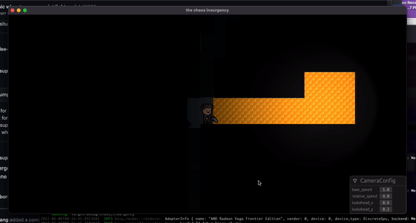

# bevy_sprite3d
[](https://crates.io/crates/bevy_sprite3d)
[](./license.md)

Use 2d sprites in a 3d [bevy](https://bevyengine.org/) scene.

This is a pretty common setup in other engines (unity, godot, etc). Useful for:
- 2d games using bevy's lighting `(orthographic camera, 3d sprites)`
- 2d games with easier parallax and scale `(perspective camera, 3d sprites)`
- 2d games in a 3d world `(perspective camera, both 3d sprites and meshes)`
- 3d games with billboard sprites (a la
  [Delver](https://cdn.cloudflare.steamstatic.com/steam/apps/249630/ss_0187dc55d24155ca3944b4ccc827baf7832715a0.1920x1080.jpg))

Both meshes and materials are internally cached, so this crate can be used for
things like tilemaps without issue.

# Examples

Example using `bevy_sprite3d`:




A more complicated scene: [`examples/dungeon.rs`](./examples/dungeon.rs). Try
this one with `cargo run --example dungeon`.

https://github.com/FraserLee/bevy_sprite3d/assets/30442265/1821b13c-9770-4f4e-a889-f67e06a3cda6


Some more examples. These don't use bevy, but demonstrate the effect style:


# Usage

Check out the [examples](./examples) for details. Tl;dr initialize the plugin with
```rust
app.add_plugins(Sprite3dPlugin)
```
and spawn sprites with
```rust
fn setup(
    mut commands: Commands,
    asset_server: Res<AssetServer>,
    mut layouts: ResMut<Assets<TextureAtlasLayout>>,
) {

    // ----------------------- Single Static Sprite ----------------------------

    commands.spawn((
        Sprite {
            image: asset_server.load("icon.png"),

            ..default()

            // color: Color::WHITE,
            // flip_x: false,
            // custom_size: None,
            // rect: None,
            // alpha_mode: SpriteAlphaMode::Blend,
        },
        Sprite3d {
            pixels_per_metre: 400.,

            unlit: true,

            ..default()

            // emissive: LinearRgba::BLACK,
            // double_sided: true,
        },
        // Anchor::CENTER, // default pivot
    ));

    // ------------------- Texture Atlas (Sprite Sheet) ------------------------

    let texture_atlas = TextureAtlas {
        layout: layouts.add(TextureAtlasLayout::from_grid(
            UVec2::new(24, 24), // tile_size
            7,                  // columns
            1,                  // rows
            None,               // padding
            None,               // offset
        )),
        index: 3,
    };

    commands.spawn((
        Sprite {
            image: asset_server.load("gabe-idle-run.png"),
            texture_atlas: Some(texture_atlas),
            ..default()
        },
        Sprite3d {
            pixels_per_metre: 32.,
            unlit: true,

            ..default()

            // emissive: LinearRgba::BLACK,
            // double_sided: true,
        },
        // Anchor::CENTER, // default pivot
    ));
}
```
or as a `bsn!` scene:
```rust
commands.queue_spawn_scene(bsn! {
    Sprite { image: "icon.png" }
    Sprite3d { pixels_per_metre: 400., unlit: true }
});
```

Note: `Sprite::alpha_mode` defaults to `Blend`, which is more expensive. Most
sprites are better off with `alpha_mode: SpriteAlphaMode::Mask(0.5)` (pixels
are either fully opaque or fully transparent), or `Opaque` for images with no
transparency.

## Versioning

| `bevy_sprite3d` version | `bevy` version |
|-------------------------|----------------|
| 10.0 - 11.0             | 0.20           |
| 9.0                     | 0.19           |
| 8.0                     | 0.18           |
| 7.0                     | 0.17           |
| 7.0.0-rc                | 0.17.0-rc      |
| 5.0 - 6.0               | 0.16           |
| 5.0.0-rc                | 0.16.0-rc      |
| 4.0                     | 0.15           |
| 3.0                     | 0.14           |
| 2.8                     | 0.13           |
| 2.7                     | 0.12           |
| 2.5 - 2.6               | 0.11           |
| 2.4                     | 0.10           |
| 2.1 - 2.3               | 0.9            |
| 1.1 - 2.0               | 0.8            |
| 1.0                     | 0.7            |
